# Abdul Rahman Sesay

**MSc Cyber Security graduate · Seeking UK Tier 1 SOC Analyst roles**

I use Splunk and Suricata to investigate authentication and network activity in controlled labs. My portfolio shows the searches, evidence and reports behind each investigation, including a simulated phishing triage case.

[Portfolio reviewer guide](REVIEWER_GUIDE.md) · [LinkedIn](https://www.linkedin.com/in/abdul-rahman-sesay-064ba0377) · [GitHub profile](https://github.com/Cyberrah)

## Featured investigation · Kestrel Logistics Group

In a three-VM VirtualBox lab, I ingested Windows and Ubuntu logs alongside Suricata EVE JSON in Splunk. I used controlled test traffic to validate a scheduled alert and correlate SSH activity across host and network records.

| Lab result | Evidence |
| --- | --- |
| Triggered a scheduled Windows alert for five failed logons in ten minutes using six controlled failures | [Alert screenshot](https://github.com/Cyberrah/Log-Analysis-Pipeline-Ingesting-and-Analysing-Security-Telemetry-with-Splunk-Enterprise-and-Suricata/blob/main/screenshots/windows-triggered-alerts.png) |
| Verified Suricata ingestion with three controlled ICMP alerts | [ICMP validation](https://github.com/Cyberrah/Log-Analysis-Pipeline-Ingesting-and-Analysing-Security-Telemetry-with-Splunk-Enterprise-and-Suricata/blob/main/screenshots/icmp-validation.png) |
| Matched failed and successful SSH authentication to two network connections using timestamps, IP addresses and source ports | [SSH timeline](https://github.com/Cyberrah/Log-Analysis-Pipeline-Ingesting-and-Analysing-Security-Telemetry-with-Splunk-Enterprise-and-Suricata/blob/main/docs/ssh-investigation.md) |

**[Explore the Kestrel lab](https://github.com/Cyberrah/Log-Analysis-Pipeline-Ingesting-and-Analysing-Security-Telemetry-with-Splunk-Enterprise-and-Suricata)** · **[Read the SOC report (PDF)](https://github.com/Cyberrah/Log-Analysis-Pipeline-Ingesting-and-Analysing-Security-Telemetry-with-Splunk-Enterprise-and-Suricata/blob/main/reports/Kestrel_SOC_Investigation_Report.pdf)** · **[View the Splunk dashboard](https://github.com/Cyberrah/Log-Analysis-Pipeline-Ingesting-and-Analysing-Security-Telemetry-with-Splunk-Enterprise-and-Suricata/blob/main/screenshots/soc-dashboard.png)**

## Project portfolio

| Project | What to review | Evidence status |
| --- | --- | --- |
| [Kestrel SOC lab](https://github.com/Cyberrah/Log-Analysis-Pipeline-Ingesting-and-Analysing-Security-Telemetry-with-Splunk-Enterprise-and-Suricata) | Splunk and Suricata telemetry pipeline, Windows alerting and SSH correlation | Observed lab results |
| [Splunk SOC Home Lab](https://github.com/Cyberrah/Splunk-SOC-Home-Lab) | Six SPL searches, forwarder configuration and a Windows authentication dashboard template | Reusable assets. Per-search testing is pending |
| [Phishing Email Analysis](https://github.com/Cyberrah/Phishing-Email-Analysis) | Email header analysis, SPF/DKIM/DMARC, IOC documentation and MITRE ATT&CK mapping | Educational simulation |

## Tools and techniques

`Splunk Enterprise` · `SPL` · `Suricata EVE JSON` · `Windows Event Logs` · `Linux authentication logs` · `MITRE ATT&CK`

More evidence and lab notes

- [Log source inventory](https://github.com/Cyberrah/Log-Analysis-Pipeline-Ingesting-and-Analysing-Security-Telemetry-with-Splunk-Enterprise-and-Suricata/blob/main/inventory/Kestrel_Log_Source_Inventory.xlsx)
- [Kestrel evidence register](https://github.com/Cyberrah/Log-Analysis-Pipeline-Ingesting-and-Analysing-Security-Telemetry-with-Splunk-Enterprise-and-Suricata/blob/main/docs/evidence-register.md)
- [Splunk detection searches and alert settings](https://github.com/Cyberrah/Log-Analysis-Pipeline-Ingesting-and-Analysing-Security-Telemetry-with-Splunk-Enterprise-and-Suricata/tree/main/detections)
- [Phishing evidence assessment](https://github.com/Cyberrah/Phishing-Email-Analysis/blob/main/Phishing_Email_Analysis_Portfolio/docs/evidence-assessment.md)

These projects cover controlled home-lab tests and educational simulations. The reviewer guide explains the scope and evidence for each project.

