# Abdul Rahman Sesay

**MSc Cyber Security graduate · Seeking UK Tier 1 SOC Analyst roles**

I use Splunk and Suricata to investigate authentication and network activity in controlled labs. My portfolio shows the searches, evidence and reports behind each investigation, including a simulated phishing triage case.

[Portfolio reviewer guide](REVIEWER_GUIDE.md) · [LinkedIn](https://www.linkedin.com/in/abdul-rahman-sesay-064ba0377) · [GitHub profile](https://github.com/Cyberrah)

## Featured investigation · Kestrel Logistics Group

In a three-VM VirtualBox lab, I ingested Windows and Ubuntu logs alongside Suricata EVE JSON in Splunk. I used controlled test traffic to validate a scheduled alert and correlate SSH activity across host and network records.

| Lab result | Evidence |
| --- | --- |
| Triggered a scheduled Windows alert for five failed logons in ten minutes using six controlled failures | [Alert screenshot](https://github.com/Cyberrah/Log-Analysis-Pipeline-Ingesting-and-Analysing-Security-Telemetry-with-Splunk-Enterprise-and-Suricata/blob/main/screenshots/windows-triggered-alerts.png) |
| Verified Suricata ingestion with three controlled ICMP alerts | [ICMP validation](https://github.com/Cyberrah/Log-Analysis-Pipeline-Ingesting-and-Analysing-Security-Telemetry-with-Splunk-Enterprise-and-Suricata/blob/main/screenshots/icmp-validation.png) |
| Matched failed and successful SSH authentication to two network connections using timestamps, IP addresses and source ports | [SSH timeline](https://github.com/Cyberrah/Log-Analysis-Pipeline-Ingesting-and-Analysing-Security-Telemetry-with-Splunk-Enterprise-and-Suricata/blob/main/docs/ssh-investigation.md) |

**[Explore the Kestrel lab](https://github.com/Cyberrah/Log-Analysis-Pipeline-Ingesting-and-Analysing-Security-Telemetry-with-Splunk-Enterprise-and-Suricata)** · **[Read the SOC report (PDF)](https://github.com/Cyberrah/Log-Analysis-Pipeline-Ingesting-and-Analysing-Security-Telemetry-with-Splunk-Enterprise-and-Suricata/blob/main/reports/Kestrel_SOC_Investigation_Report.pdf)** · **[View the Splunk dashboard](https://github.com/Cyberrah/Log-Analysis-Pipeline-Ingesting-and-Analysing-Security-Telemetry-with-Splunk-Enterprise-and-Suricata/blob/main/screenshots/soc-dashboard.png)**

## Project portfolio

| Project | What I did | Evidence |
| --- | --- | --- |
| [Kestrel SOC Lab](https://github.com/Cyberrah/Log-Analysis-Pipeline-Ingesting-and-Analysing-Security-Telemetry-with-Splunk-Enterprise-and-Suricata) | Validated a Splunk alert for repeated Windows logon failures and correlated SSH authentication with Suricata flows. | [SSH investigation timeline](https://github.com/Cyberrah/Log-Analysis-Pipeline-Ingesting-and-Analysing-Security-Telemetry-with-Splunk-Enterprise-and-Suricata/blob/main/docs/ssh-investigation.md) |
| [MediSure Phishing Investigation](https://github.com/Cyberrah/Strengthening-Cyber-Resilience-through-Phishing-Email-Investigation-and-Response-in-Healthcare-) | Triaged a simulated vendor-invoice email, compared payment destinations and documented the evidence needed to assess impact. | [Analyst handoff](https://github.com/Cyberrah/Strengthening-Cyber-Resilience-through-Phishing-Email-Investigation-and-Response-in-Healthcare-#7-report-and-hand-off) |
| [Meridian Vulnerability Management](https://github.com/Cyberrah/Vulnerability-Management-Lifecycle-Scanning-Documenting-and-Remediating-with-Greenbone-OpenVAS) | Used Greenbone and Ansible to assess and remediate an Ubuntu server, then verified four targeted findings with authenticated rescans. | [Final verification scan](https://github.com/Cyberrah/Vulnerability-Management-Lifecycle-Scanning-Documenting-and-Remediating-with-Greenbone-OpenVAS/blob/main/evidence/scans/06-post-ssb-mitigation.pdf) |

## Tools and techniques

`Splunk Enterprise` · `SPL` · `Suricata EVE JSON` · `Windows Event Logs` · `Linux authentication logs` · `MITRE ATT&CK`

More evidence and lab notes

- [Log source inventory](https://github.com/Cyberrah/Log-Analysis-Pipeline-Ingesting-and-Analysing-Security-Telemetry-with-Splunk-Enterprise-and-Suricata/blob/main/inventory/Kestrel_Log_Source_Inventory.xlsx)
- [Kestrel evidence register](https://github.com/Cyberrah/Log-Analysis-Pipeline-Ingesting-and-Analysing-Security-Telemetry-with-Splunk-Enterprise-and-Suricata/blob/main/docs/evidence-register.md)
- [Splunk detection searches and alert settings](https://github.com/Cyberrah/Log-Analysis-Pipeline-Ingesting-and-Analysing-Security-Telemetry-with-Splunk-Enterprise-and-Suricata/tree/main/detections)
- [MediSure phishing lookup evidence](https://github.com/Cyberrah/Strengthening-Cyber-Resilience-through-Phishing-Email-Investigation-and-Response-in-Healthcare-#investigation-screenshots)
- [Meridian vulnerability register](https://github.com/Cyberrah/Vulnerability-Management-Lifecycle-Scanning-Documenting-and-Remediating-with-Greenbone-OpenVAS/blob/main/reports/vulnerability-register.csv)

These projects cover controlled home-lab tests and educational simulations. The reviewer guide explains the scope and evidence for each project.

